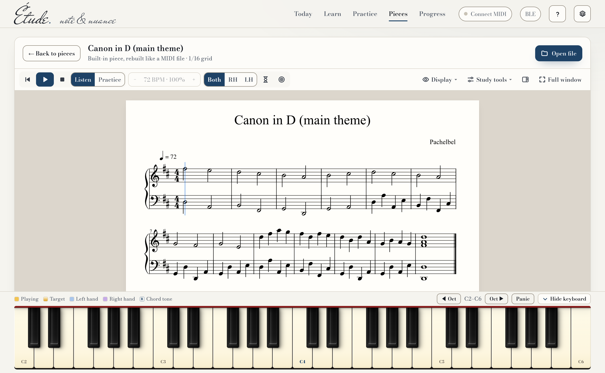
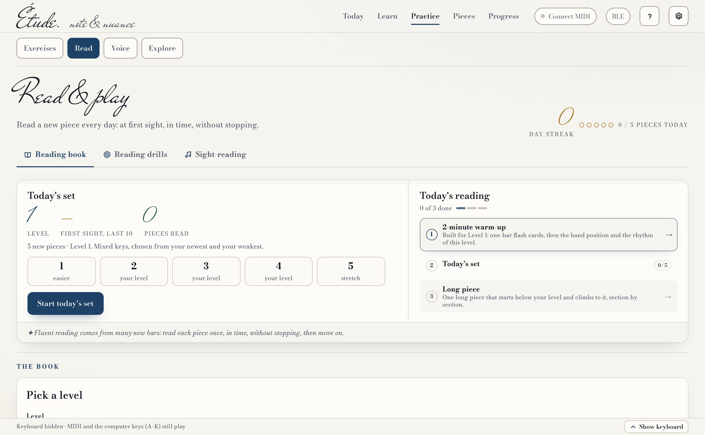
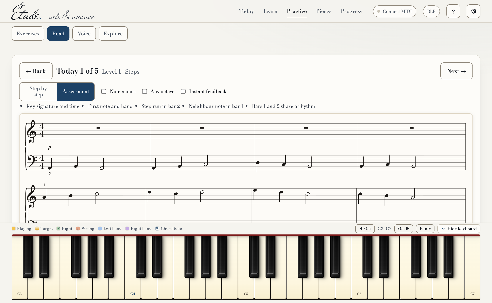
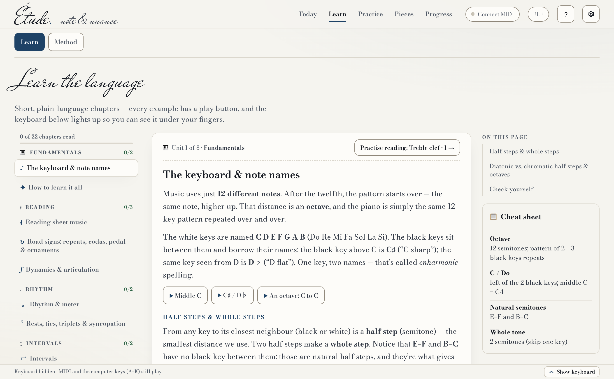
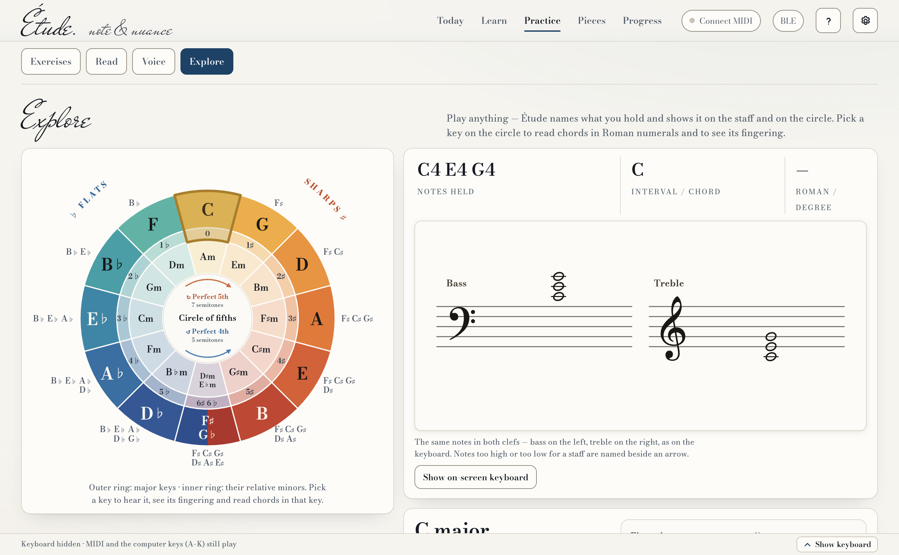
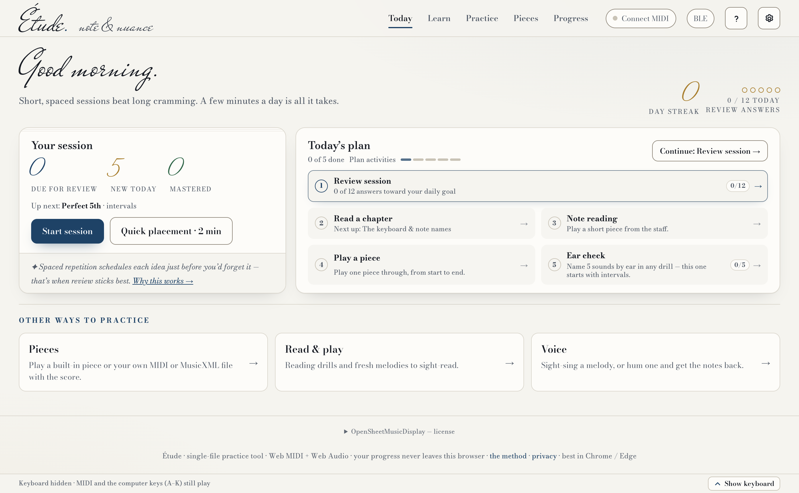
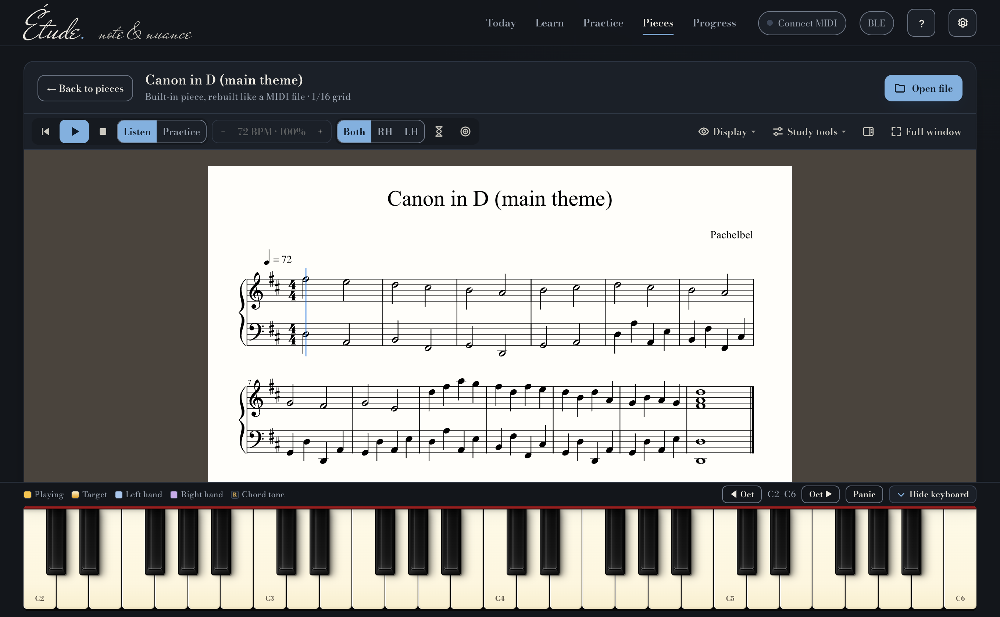
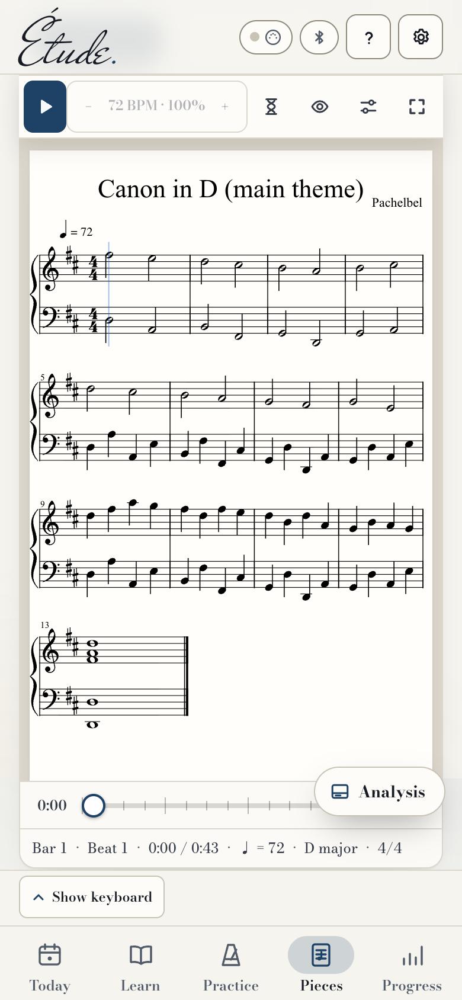
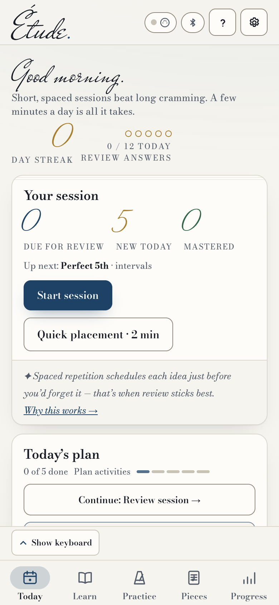

<div align="center">
  
  <h1>Étude</h1>
  <p><strong>Note &amp; nuance</strong> — piano theory, sight-reading, ear training, and interactive score practice.</p>

  <p>
    <a href="https://maurs9.github.io/etude/etude.html">
      
    </a>
    <a href="https://github.com/Maurs9/etude/releases/latest">
      
    </a>
    
    
  </p>

  <p>
    <a href="#features">Features</a> •
    <a href="#screenshots">Screenshots</a> •
    <a href="#digital-piano--midi-setup">MIDI Setup</a> •
    <a href="#run-locally">Run Locally</a> •
    <a href="#testing--maintenance">Tests</a> •
    <a href="#project-structure">Architecture</a>
  </p>
</div>

<br />

<div align="center">
  <picture>
    <source media="(prefers-color-scheme: dark)" srcset="docs/screenshots/score-player-dark.png" />
    <source media="(prefers-color-scheme: light)" srcset="docs/screenshots/score-player-light.png" />
    
  </picture>
  <sub><em>Interactive score player with OpenSheetMusicDisplay engraving, hands-separate practice, tempo control, and live keyboard (auto-switches Light / Dark with GitHub theme).</em></sub>
</div>

---

## Overview

**Étude** is an offline-first, privacy-respecting piano theory and practice studio built as a static Vite PWA and Android Trusted Web Activity (TWA). Everything runs locally in your browser or Android app—your practice history, recordings, and imported scores never leave your device.

- **Web App:** [maurs9.github.io/etude/etude.html](https://maurs9.github.io/etude/etude.html)
- **Android APK:** [Latest GitHub Release](https://github.com/Maurs9/etude/releases/latest)
- **Languages:** English, Romanian, German, Spanish, French, Italian, and Portuguese (BR)

---

## Features

| Area | What you get |
| --- | --- |
| **Sight-Reading (`Read`)** | Three tabs: **Reading book**, **Reading drills**, and a free **Sight-reading** generator. 8 progressive levels across 24 keys (eighths, dotted notes, syncopation, ties). Each level includes a 96-piece generated book in 12 folding units, 20-piece key runs, and a **Today's reading** plan: a 2-minute flash-card warm-up, **Today's set** (5 fresh pieces/day), and a 24–48 bar long piece. First-sight attempts are scored for pitch, rhythm, and timing (up to 3 stars), and step-by-step mode asks for chords played together. |
| **Pieces & My Library (`Pieces`)** | 23 built-in pieces plus your own **MIDI** or **MusicXML** files (add several files or a whole folder at once) in one unified player with tempo control, passage loops, hands separate, **Wait for me** mode, note names, mistake breakdowns, sustain-pedal grading, automatic 5-axis difficulty stars, and full-window view. |
| **Explore (`Explore`)** | Free play on a single screen pairing an interactive **Circle of Fifths** with live bass & treble staves. Hold any note or chord to identify it in Roman numerals, inspect scale fingerings, and audition the seven diatonic chords of any key. |
| **Learn (`Learn`)** | 22 short chapters in 8 units, each with play buttons that light up the keyboard, a chapter check, and a cheat sheet. On wide screens a side rail shows the chapter outline and the cheat sheet. Includes a glossary and the **Method** page. |
| **Targeted Drills** | Spaced-repetition daily sessions, interval drills with song hints, chord progression play-along loops, scale & arpeggio technique drills, and reading challenges (*Time Attack*, *Survival*, *Marathon*). |
| **Voice (`Voice`)** | Sight-sing a melody from the staff with live pitch feedback, or hum a melody and convert it back to MIDI or text. Keys or MIDI can answer in place of voice. |
| **Error-Aware Feedback** | Wrong answers compare what you played against the target with a **Hear both** button; repeated mix-ups automatically trigger a short contrast drill at the end of the session. |
| **Hardware MIDI & Mobile UX** | Wired **USB MIDI** and direct **Web Bluetooth MIDI** with event-time judging, auto-reconnect, and per-input latency calibration (**Settings → MIDI**). Landscape phone mode widens the keyboard dock for comfortable play. |
| **Offline & Data Safety** | Installable PWA with offline caching, Screen Wake Lock, persistent storage requests, 3 days of automatic local backups, pre-reset/import snapshots, and one JSON backup with progress, settings, history, and the score library (**Settings → Your data → Backup**). Older progress and library backups still import. |
| **Accessibility** | Keyboard navigation throughout (the chapter list, the circle of fifths, and the drill grid each take one Tab stop, with arrow keys inside), control borders at 3:1 contrast, small controls of at least 24 px, page titles in the interface language, and focused controls that stay clear of the phone bars. |

---

## Screenshots

### Desktop

<table>
  <tr>
    <td width="50%" align="center">
      <br />
      <sub><strong>Read &amp; play</strong> — Today's set, a three-step daily reading plan, and the level book</sub>
    </td>
    <td width="50%" align="center">
      <br />
      <sub><strong>Sight-Reading</strong> — engraved daily sets with dynamics, reading focus, and star grading</sub>
    </td>
  </tr>
  <tr>
    <td width="50%" align="center">
      <br />
      <sub><strong>Learn</strong> — short chapters with play buttons, an outline, and a cheat sheet</sub>
    </td>
    <td width="50%" align="center">
      <br />
      <sub><strong>Explore</strong> — interactive Circle of Fifths, live chord detection, and scale fingerings</sub>
    </td>
  </tr>
  <tr>
    <td width="50%" align="center">
      <br />
      <sub><strong>Today</strong> — spaced-repetition review queue and 5-step daily practice plan</sub>
    </td>
    <td width="50%" align="center">
      <br />
      <sub><strong>Dark Mode</strong> — comfortable low-light practice with high-contrast score framing</sub>
    </td>
  </tr>
</table>

### Mobile & Android TWA

<div align="center">
  
  &nbsp;&nbsp;&nbsp;&nbsp;
  
  <br />
  <sub><em>Fit-width mobile score layout, touch navigation, and native-feeling bottom tab bar on Android TWA &amp; mobile browsers.</em></sub>
</div>

---

## Digital Piano & MIDI Setup

1. Open [maurs9.github.io/etude/etude.html](https://maurs9.github.io/etude/etude.html) in **Google Chrome** or **Microsoft Edge** (Android, Windows, or macOS), or install the [Android APK](https://github.com/Maurs9/etude/releases/latest).
2. In **Settings → App & screen**, click **Install** for offline standalone mode and enable **Keep the screen on**.
3. Connect your instrument:
   - **Bluetooth MIDI (wireless):** Enable Bluetooth MIDI on your piano (disconnect it from other apps first), then open **Settings → Bluetooth MIDI (direct) → Connect**.
   - **USB MIDI (wired):** Connect the piano's **USB to Host** port via USB-C; it appears automatically under **Settings → MIDI input**.
   - With a MIDI piano connected, playing the first right note in **Read** starts the attempt automatically and advances to the next piece when finished.

---

## Run Locally

Requires **Node.js 22+**.

```sh
npm ci
npm run dev
```

Open [http://localhost:5173/etude.html](http://localhost:5173/etude.html). Serving over `localhost` or HTTPS is recommended for Service Worker caching, Web MIDI, and microphone access.

| Build Command | Output |
| --- | --- |
| `npm run build` | Production GitHub Pages-shaped bundle in `dist/etude/` |
| `npm run preview` | Build and preview locally on port `8778` |
| `npm run build:standalone` | Single-file offline build at `dist/etude-standalone.html` (opens directly via `file://`) |

---

## Testing & Maintenance

The test suite uses **Node.js**, **Vitest**, **Playwright** (using installed Google Chrome by default), and **Python 3**.

```sh
npm run typecheck      # Strict TypeScript + suppression guard
npm run lint           # ESLint
npm run test:unit      # Vitest unit & architecture invariant tests (tests/unit/)
npm run test:i18n      # Multi-language pack tests (i18n/tests/)
npm test               # Playwright E2E against built dist/etude/ + @sw tests
npm run deps:check     # Check npm devDependencies + vendor versions
npm run update:deps    # Update devDependencies in safe groups with rollback
npm run osmd:check     # Verify OSMD bundle contract and check for updates
npm run update:osmd    # Upgrade vendored OSMD bundle with EngravingRules diff & rollback
npm run perf:baseline  # Measure production performance baseline against dist/etude/
```

To run Playwright against the Vite dev server (including standalone specs):

```sh
npm run build:standalone -- --test-surface
npm run test:dev
```

> **Tip:** To use Playwright's bundled Chromium instead of system Chrome, run `npx playwright install chromium` and set `PW_CHANNEL=` (empty). Playwright starts its own local server on port `8787`.

---

## Project Structure

<details>
<summary><strong>Directory layout &amp; TypeScript safety gates</strong></summary>

<br />

- `etude.html` — stable application shell URL
- `src/domain/views-runtime.ts` — browser entry (shell): routing, the progress write gateway, feature loading, and boot
- `src/app/` — shell modules: keyboard dock, input bus, persistence, settings and control wiring, devices, coaching
- `src/features/` — lazy feature slices loaded on first visit (`today`, `learn`, `practice`, `read`, `explore`, `voice`, `score-library`, `score-player`, `progress`)
- `src/core/` — browser-free shared logic (multi-tab sync merge, spaced repetition, trainer items, reading curriculum, pitch matching, Learn progress)
- `src/infra/` — browser and device adapters (PWA lifecycle, MIDI controller, score file drop)
- `src/domain/` — strict TypeScript domain modules (`storage.ts` for the `ptt-v3` schema, `data-safety.ts`, `backup-transfer.ts`, `audio.ts`, `notation.ts`, `theory.ts`, `router.ts`, `midi-timing.ts`, `technique*.ts`, `feedback.ts`, `score-library-*.ts`)
- `src/sight-reading/` — sight-reading generators, evaluation, ledger, and notation (`levels.ts`, `patterns.ts`, `rules.ts`, `melody.ts`, `book.ts`, `progress.ts`, `score.ts`, `warmup.ts`)
- `src/locales/` — English, Romanian, German, Spanish, French, Italian, and Portuguese (BR) UI strings, lessons, and quizzes
- `src/styles/`, `src/assets/fonts/`, `src/assets/piano/` — self-hosted font subsets, modular feature CSS, and hashed piano audio samples
- `public/` — static public assets, `manifest.webmanifest`, app icons, and lazy-loaded OSMD 3.0.0 bundle (`public/vendor/osmd-3.0.0.min.js`)
- `android-twa/` — Bubblewrap Trusted Web Activity configuration (`twa-manifest.json`) for Android APK/AAB builds
- `i18n/` — supplementary multi-language pack runtime (`i18n/framework/`) and tests (`i18n/tests/`)
- `scripts/` — build (`build.mjs`, `build-standalone.mjs`, `generate-sw.mjs`), Android release verification (`android-release.mjs`), quality gates (`check-ts-suppressions.mjs`), emergency rollback (`sw-kill-switch.js`), and dependency updaters (`update-deps.mjs`, `update-osmd.mjs`)
- `tests/` — Vitest unit/invariant tests (`tests/unit/`), Playwright E2E specs (`tests/e2e/`, `tests/e2e/sight-reading/`), shared helpers (`tests/helpers/`), and MusicXML fixtures/baselines (`tests/fixtures/`, `tests/golden/`)
- `docs/` — screenshots (`docs/screenshots/`), plans (`docs/plans/`), i18n notes (`docs/i18n/`), and runbooks (`docs/runbooks/device-smoke.md`, `docs/runbooks/android-twa.md`)

`npm run typecheck` runs the strict compiler gate for typed domain modules and enforces `scripts/check-ts-suppressions.mjs` (rejecting `@ts-nocheck`, `@ts-ignore`, unexplained `@ts-expect-error`, explicit `any`, unchecked application JS, and dynamically compiled runtime payloads).

</details>

<details>
<summary><strong>Experimental Score Difficulty Scorer &amp; Calibration CLI</strong></summary>

<br />

**My Library** automatically calculates and saves 5-axis difficulty star ratings for existing and newly imported scores:

- Sort by **Difficulty (stars)** from fewest to most stars; open a title to start or resume from your saved position.
- Combine an overall star range with a single-axis range in **Filters**, and inspect decisive measures under **More → Difficulty details**.
- If a score lacks a written tempo, it receives a provisional rating—use **Set BPM** in difficulty details to enter a verified starting tempo and recalculate. **Settings → Your data → Backup** includes the score library, its star ratings, and practice positions.
- In **Read**, **New reading exercise** selects a fresh piece using the experimental scorer with a fingerprint-based ID, leaving numbered book results and daily sets intact.

#### CLI Reports & Calibration (Node.js 22)

```sh
# Inspect books (levels 1–8) or fresh generated exercises
node --disable-warning=MODULE_TYPELESS_PACKAGE_JSON scripts/score-difficulty-report.mjs --level 1 --json
node --disable-warning=MODULE_TYPELESS_PACKAGE_JSON scripts/score-difficulty-report.mjs --fresh

# Calibrate thresholds against a local manifest of graded arrangements (grades 1–6)
node scripts/calibrate-score-difficulty.mjs manifest.json > profile.json
```

Manifest rows follow `{"file":"scores/example.mxl","level":2,"split":"fit","group":"exact-work"}` (with optional `"bpm":108` when starting tempo is missing). Keep related arrangements in the same `group`, include both `fit` and held-out references per grade, and pass `--report-only` to inspect scores and decisive measures without fitting.

</details>
