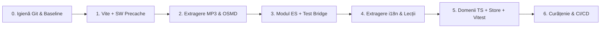

# Plan de migrare a arhitecturii Étude (Versiune finală revizuită)

**Data:** 2026-11-07
**Stare:** propunere revizuită și verificată pe cod, neaplicată încă
**Premisă:** regula „the app itself has no build step” nu se mai aplică; un pas de build (Vite + TypeScript) este permis.

---

## 1. Diagnosticul stării actuale (măsurat pe cod)

[etude.html](../../etude.html) are **4.96 MB** (10.106 linii), dar ~80% din dimensiune nu este cod al aplicației:

| Componentă | Localizare în `etude.html` | Dimensiune | Pondere |
|---|---|---|---|
| **Sample-uri de pian** (30 MP3-uri, MIDI `21..108` din 3 în 3 semitonuri, base64 în `#piano-recordings`) | L2064 | 2.68 MB (≈2.0 MB binar) | 54% |
| **OpenSheetMusicDisplay 1.9.9** (cu VexFlow inclus, minificat inline) | L2065–2066 | 1.22 MB | 25% |
| **Codul JS al aplicației** (`"use strict"`, 857 funcții, 164 `const`, 18 `let` la nivel global) | L2067–10104 | 839 KB | 17% |
| **CSS inline** (`<style>`) | L23–1321 | 113 KB | 2.3% |
| **HTML** (`<body>`) | L1323–2063 | 83 KB | 1.7% |

### Constrângeri și cuplaje reale identificate în cod și teste

1. **Contractul PWA instalat (nu are voie să se schimbe):**
   - `start_url: ./etude.html` în [manifest.webmanifest](../../manifest.webmanifest);
   - Service Worker înregistrat la `./sw.js` cu `scope: './'` (L4200);
   - Starea utilizatorului în `localStorage['ptt-v3']`.
2. **Suita Playwright ([tests/app.spec.mjs](../../tests/app.spec.mjs)) depinde de simboluri globale și de monkey-patching:**
   - 134 de teste cu 214 apeluri `page.evaluate(...)` citesc direct funcții și stări globale (`show`, `t`, `setLang`, `SES`, `ITEMS`, `AN`, `sing`, `pianoBank` etc.), iar [tests/fixtures.mjs](../../tests/fixtures.mjs#L18) așteaptă `typeof window.show === 'function'`.
   - **7 funcții declarate în script sunt suprascrise (monkey-patched) direct în teste** pentru spy/mock:
     - `pianoDecode` (L491, L514, L535, L558, L579, L594)
     - `makePianoVoice` (L515, L536, L559, L580, L595)
     - `previewNote` (L317)
     - `preparePiano` (L626)
     - `anInflatedSize` (L953, L1015)
     - `playInterval` (L1042)
     - `syncPull` (L1326)
   - **5 variabile `let` sunt reasignate direct în teste:** `actx`, `theme`, `localSynth`, `lang`, `notation`.
   - Deoarece callback-urile din `page.evaluate(() => { pianoDecode = mock })` nu rulează în `"use strict"`, o atribuire către un simbol neexpus ca setter nu aruncă `ReferenceError`, ci creează tăcut `window.pianoDecode` fără să afecteze funcția internă din modul.
3. **Două teste din `tests/app.spec.mjs` citesc `etude.html` direct de pe disc cu `readFileSync`:**
   - L37–55 (`no string key is defined twice in a language`) caută `'const STRINGS={'` în `etude.html`;
   - L1511–1516 (`unused leftovers stay removed`) caută `'function demoBeat('` în `etude.html`.
4. **Cuplajul cu OpenSheetMusicDisplay (OSMD):**
   - Folosit în 3 locuri: `scoreRender()` (L8005, deja `async`), `scorePatchOsmd()` (L8091, apelat din `scoreRender`) și `anReadXml()` (L9065, deja `async`).
   - `scorePatchOsmd()` modifică prototipul intern `opensheetmusicdisplay.VexFlowMusicSheetDrawer.prototype.drawPedals`.
   - Două teste `.mxl` din [tests/app.spec.mjs](../../tests/app.spec.mjs#L937) (L937 și L950) accesează `opensheetmusicdisplay.MXLHelper.MXLtoXMLstring` imediat după deschiderea `#analysis` pe gol (înainte ca vreun fișier să fie încărcat).
5. **Validatorul i18n (`i18n-framework/inventory.cjs`):**
   - Extrage dicționarele din `etude.html` căutând delimitatori de text (`'const STRINGS={'` … `'\nfunction t(k'`).
   - În codul aplicației există **24 de ramuri `lang === 'ro'`** și verificări sincrone `if (STRINGS[v])` în `loadAll()` (L9829) și `SYNC_PREFS.lang` (L9724).

---

## 2. Arhitectura aleasă: Vite + TypeScript introdus treptat, fără framework UI

| Variantă | Notă | Verdict |
|---|---|---|
| A. Monolit `etude.html` + script de concatenare | 4/10 | Nu rezolvă invalidarea cache-ului de 5 MB la fiecare modificare de cod. |
| B. Module ES native fără build | 7/10 | Necesită invalidare manuală de cache în SW, fără minificare și fără code-splitting automat. |
| **C. Vite + TypeScript treptat, fără framework UI** | **9/10** | **Aleasă.** |
| D. Vite + Svelte 5 / Solid pe ecranele de UI | 7.5/10 | Opțiune ulterioară, reevaluată doar după finalizarea modularizării (§7). |
| E. Rescriere completă într-un framework UI | 3/10 | Risc ridicat de regresie, zero beneficii pentru MIDI, audio și Canvas. |

### Structura țintă a proiectului

```
etude/
├─ etude.html                    ← intrarea Vite: structura HTML + <script type="module" src="/src/main.ts">
├─ public/                       ← copiate cu URL stabil (fără hash)
│  ├─ manifest.webmanifest
│  └─ icons/…
├─ src/
│  ├─ main.ts                    ← inițializare aplicație
│  ├─ vendor/
│  │  └─ osmd-1.9.9.min.js       ← bundle-ul OSMD existent extras din etude.html, încărcat la cerere
│  ├─ core/
│  │  ├─ store.ts                ← stare reactivă (signals) + persistare ptt-v3
│  │  ├─ storage.ts              ← încărcare/salvare/migrare v2→v3, sync multi-tab, backup
│  │  └─ dom.ts                  ← $, helpers DOM
│  ├─ theory/                    ← FUNCȚII PURE (fără DOM / window)
│  │  ├─ pitch.ts  spelling.ts   ← letter / solfege / german (H/B)
│  │  ├─ intervals.ts  chords.ts  scales.ts  keys.ts
│  │  └─ *.test.ts               ← teste unitare Vitest
│  ├─ i18n/
│  │  ├─ index.ts                ← t(), tl(), setLang(), formatare Intl
│  │  ├─ keys.d.ts               ← tipuri generate automat din en/strings.json
│  │  └─ locales/
│  │     ├─ en/ strings.json  music.json  units.json  glossary.json  quizzes.json  summaries.json
│  │     │      lessons/<id>.html
│  │     └─ ro/ … (aceeași schemă)
│  ├─ audio/                     ← context, sampler, sinteză, metronom, detecție pitch
│  ├─ midi/                      ← WebMIDI, parser Web Bluetooth MIDI
│  ├─ notation/                  ← portativ SVG, falling notes, adaptor OSMD
│  ├─ modes/                     ← learn, read, ear, drill, accomp, sing, play, analyze, plan, progress
│  ├─ ui/                        ← drawer setări, nav, dock, dialoguri
│  ├─ styles/                    ← CSS modularizat
│  ├─ sw.ts                      ← service worker (compilat prin vite-plugin-pwa injectManifest)
│  └─ test-api.ts                ← hook-uri pentru Playwright
├─ assets/piano/piano-21.mp3 … piano-108.mp3   ← primesc hash la build
├─ tests/                        ← Playwright E2E
├─ i18n-framework/               ← validatorul adaptat să citească din src/i18n/locales/
├─ vite.config.ts  tsconfig.json  eslint.config.js
└─ .github/workflows/ci.yml
```

### Strategia de caching în Service Worker (`sw.ts` cu `injectManifest`)

| Resursă | Strategie | Motiv |
|---|---|---|
| `etude.html` | Network-first cu timeout (8s) | Păstrează regula actuală: utilizatorul primește mereu ultima versiune când e online. |
| JS, CSS, chunk-ul OSMD, chunk-uri de limbă (cu hash) | Precache la instalare + Cache-first | Fișiere imutabile; funcționare 100% offline pentru toate limbile și partiturile. |
| Cele 30 de sample-uri `piano-<midi>.<hash>.mp3` (~2 MB total) | Precache la instalare + Cache-first | Încărcare prioritară a octavei centrale (`48..84`) la prima vizită și funcționare completă offline. |
| `manifest.webmanifest`, `icons/*` | Stale-while-revalidate | URL-uri fixe fără hash. |

> **Detaliu tehnic important:** Deoarece Vite extrage automat chiar și `<style>` inline din `etude.html` într-un fișier extern `assets/*.css`, integrarea `vite-plugin-pwa` (`injectManifest`) se face încă de la introducerea lui Vite în Pasul 1, astfel încât toate resursele generate în `dist/assets/` să fie prezente în precache-ul Service Worker-ului. Pentru resursele cu hash în nume se folosește `{ cache: 'default' }` (nu `'no-cache'`), evitând dubla descărcare între pagină și Service Worker la prima vizită.

---

## 3. Pașii de migrare

Fiecare pas este un PR independent, reversibil, care păstrează suita Playwright de bază verde.



### Pasul 0: Igienă Git și măsurători de referință (~0.5 zile)

- [ ] **Curățarea arborelui de lucru** (fără a depinde de un nume fix de branch):
  - Decide soarta modificărilor din `git stash list` (`stash@{0}` conține implementarea notației germane `H / B` în `etude.html`) și a branch-urilor neintegrate: fie se integrează în `main` înainte de migrare, fie se salvează pe branch-uri dedicate.
  - Mută sau îngheață testele neurmărite care testează funcționalități neintegrate încă în `etude.html` (de ex. `tests/e2e-localization.spec.mjs` pentru cele 5 limbi în lucru, sau `tests/german-notation.spec.mjs` dacă `stash@{0}` nu este aplicat încă).
- [ ] Creează `.gitignore` (`node_modules/`, `dist/`, `test-results/`, `__pycache__/`, `*.pyc`, `.agents/`, `.hermes/`) și elimină din indexul Git fișierele deja urmărite din greșeală:
  ```sh
  git rm -r --cached i18n-framework/__pycache__ i18n-framework/test-results
  ```
- [ ] Pune tag-ul `pre-migration` și notează valorile de referință (timp de rulare Playwright, dimensiuni transferate).

**Criteriu de validare:** `git status` este curat, iar suita de teste activă + `python -m unittest discover -s i18n-framework` trec 100%.

---

### Pasul 1: Scheletul Vite + Service Worker cu manifest injectat (~0.5–1 zi)

- [ ] Instalează `vite`, `typescript`, `vite-plugin-pwa`.
- [ ] Configurează `vite.config.ts`:
  - `base: './'`;
  - `build.rollupOptions.input: { etude: 'etude.html' }`;
  - `VitePWA({ strategies: 'injectManifest', srcDir: 'src', filename: 'sw.ts', injectRegister: null, manifest: false })`.
- [ ] Mută `manifest.webmanifest` și `icons/` în `public/`.
- [ ] Mută `sw.js` în `src/sw.ts`, păstrând strategia network-first pentru `etude.html` și adăugând lista generată automat `self.__WB_MANIFEST` (cu `{ cache: 'default' }` pentru fișierele cu hash din `assets/`, astfel încât CSS-ul extras automat de Vite să fie disponibil offline).
- [ ] Actualizează `playwright.config.mjs` pentru a rula pe output-ul de build (`npm run build && vite preview --port 8787 --strictPort`).
- [ ] Configurează workflow-ul GitHub Actions pentru a publica `dist/` pe GitHub Pages (păstrând URL-ul `https://maurs9.github.io/etude/etude.html`).

**Criteriu de validare:** `dist/etude.html` funcționează identic online și offline, iar toate testele Playwright trec pe `vite preview`.

---

### Pasul 2: Extragerea sample-urilor MP3 și a bibliotecii OSMD (~1–2 zile)

Acest pas reduce `etude.html` de la **4.96 MB la ~950 KB** (înainte de minificare).

- [ ] **Sample-urile de pian (30 de fișiere `.mp3`):**
  - Un script `scripts/extract-samples.mjs` decodează o singură dată JSON-ul base64 din `#piano-recordings` în `assets/piano/piano-21.mp3` … `piano-108.mp3` și elimină tag-ul `<script id="piano-recordings">` din `etude.html`.
  - Păstrarea celor 30 de fișiere individuale menține comportamentul din `preparePiano()` (care încarcă și decodează prioritar cele 13 note centrale `MIDI 48..84`, apoi restul în `requestIdleCallback`) și elimină complet parsarea JSON de 2.7 MB și bucla `atob()`.
  - `pianoKeys()` returnează constanta `[21, 24, 27, ..., 108]`.
  - `pianoDecode(key)` face `fetch(PIANO_SAMPLE_URLS[key]).then(r => r.arrayBuffer())` și trimite bufferul direct la `ctx.decodeAudioData(...)`.
- [ ] **OpenSheetMusicDisplay (OSMD):**
  - Extrage exact scriptul minificat existent de la L2065–2066 în `src/vendor/osmd-1.9.9.min.js` (zero risc de incompatibilitate cu monkey-patch-ul din `scorePatchOsmd()`).
  - Creează un loader **idempotent**:
    ```js
    let osmdPromise = null;
    window.loadOsmd = function loadOsmd() {
      if (window.opensheetmusicdisplay) return Promise.resolve(window.opensheetmusicdisplay);
      return osmdPromise ||= import('./vendor/osmd-1.9.9.min.js')
        .then(m => (window.opensheetmusicdisplay = m.default ?? window.opensheetmusicdisplay));
    };
    ```
  - În `scoreRender()` (L7995) și `anReadXml()` (L9062) — ambele fiind deja `async function` — se adaugă `await loadOsmd()` înainte de utilizarea `opensheetmusicdisplay`.
  - În [tests/app.spec.mjs](../../tests/app.spec.mjs#L936) (L936 și L950), adaugă `await loadOsmd()` la începutul `page.evaluate`, înainte de atașarea spionului pe `opensheetmusicdisplay.MXLHelper.MXLtoXMLstring`. (Deoarece `loadOsmd()` este idempotent, apelul ulterior din `anReadXml` nu va suprascrie spionul).
- [ ] **Test E2E offline nou:** După prima vizită și activarea Service Worker-ului, se trece contextul în `context.setOffline(true)`, se reîncarcă pagina și se verifică redarea unei note și încărcarea unei partituri în `#analysis`.

**Criteriu de validare:** Toate testele Playwright + noul test offline sunt verzi; modificarea unei linii de cod nu mai invalidează cache-ul celor 2 MB de sample-uri sau al celor 1.2 MB de OSMD.

---

### Pasul 3: Trecerea scriptului principal la modul ES + Puntea de compatibilitate pentru teste (~1–2 zile)

- [ ] Mută CSS-ul în `src/styles/app.css` și scriptul principal în `src/legacy/app.js`, încărcat prin `<script type="module" src="/src/main.ts">`.
- [ ] **Puntea de compatibilitate (`src/legacy/expose.js`):**
  - Expune pe `window` funcțiile și obiectele citite de `page.evaluate` în teste (`show`, `t`, `setLang`, `startSession`, `endSession`, `SES`, `ITEMS`, `AN`, `sing`, `pianoBank`, `SYNC` etc.).
  - Pentru **cele 7 funcții suprascrise (monkey-patched) în teste** (`pianoDecode`, `makePianoVoice`, `previewNote`, `preparePiano`, `anInflatedSize`, `playInterval`, `syncPull`) și pentru **variabilele `let` modificate în teste** (`actx`, `theme`, `localSynth`, `lang`, `notation`):
    - În `src/legacy/app.js`, cele 7 funcții se declară ca variabile `let` (`let pianoDecode = function(key) { ... }`), iar în `expose.js` sunt definite cu `Object.defineProperty(window, name, { get: () => binding, set: v => { binding = v; } })`.
    - Astfel, când un test evaluează `pianoDecode = mock`, el modifică chiar referința internă apelată de `sampledPianoVoice`.
- [ ] **Actualizarea celor 2 teste statice cu `readFileSync` din [tests/app.spec.mjs](../../tests/app.spec.mjs):**
  - La L39 (`no string key is defined twice`) și L1512 (`unused leftovers stay removed`), testele sunt actualizate să citească din `src/legacy/app.js` în loc de `etude.html`.
- [ ] Configurează ESLint cu `no-undef`, `no-implicit-globals` și `import-x/no-cycle`.

**Criteriu de validare:** Toate cele 134 de teste din `app.spec.mjs` și `android-adaptive-ux.spec.mjs` trec, iar ESLint raportează 0 erori.

---

### Pasul 4: Separarea traducerilor și a conținutului educațional (~3–4 zile)

- [ ] Extrage din `src/legacy/app.js` dicționarele și conținutul în `src/i18n/locales/{en,ro}/`:
  - `strings.json` (1.354 chei UI)
  - `music.json` (`intervals`, `scales`, `chords`, `categories`, `inversions`, `feels`, `songs`)
  - `units.json`, `glossary.json`, `quizzes.json`, `summaries.json`
  - `lessons/<id>.html` (cele 22 de lecții ca fișiere HTML individuale, importate cu `?raw`).
- [ ] **Gestionarea sincronă vs. asincronă a limbilor:**
  - Înlocuiește verificările `if (STRINGS[v])` din `loadAll()` (L9829) și `SYNC_PREFS.lang` (L9724) cu `if (SUPPORTED_LANGS.has(v))`.
  - **Opțiunea A (recomandată pentru simplitate cât timp sunt puține limbi):** Dicționarele ușoare de UI (`strings.json` + `music.json`, ~12–15 KB gzip/limbă) sunt incluse direct, iar doar pachetele grele de conținut (`lessons`, `quizzes`, `glossary`) se încarcă la cerere când utilizatorul deschide modul *Learn*. Astfel, `setLang()`, `loadAll()` și `SYNC_PREFS.lang` rămân 100% sincrone.
  - **Opțiunea B (încărcare leneșă completă per limbă):** La pornire, `main.ts` face `await loadLocale(initialLang)` **înainte** de a expune `window.show`. `setLang(l)` folosește un contor de cerere (pentru a ignora răspunsurile întârziate la click-uri rapide), execută `rdOnLocale()` și `saveAll()` după încărcarea dicționarului și **returnează `Promise`-ul**, astfel încât `await page.evaluate(() => setLang('ro'))` din Playwright să aștepte finalizarea.
- [ ] Generează automat `src/i18n/keys.d.ts` din `en/strings.json` pentru verificarea statică a cheilor în `t(key)`.
- [ ] Elimină cele 24 de ramuri `lang === 'ro'` din logica aplicației, mutând datele în `locales/` și folosind `Intl.Collator`, `Intl.ListFormat`, `Intl.NumberFormat` și `Intl.DateTimeFormat`.
- [ ] Actualizează `i18n-framework/validator.py` să valideze direct `src/i18n/locales/<lang>/` față de `src/i18n/locales/en/` (eliminând parsarea fragilă prin string-matching din `inventory.cjs` și înlocuind testul L39 din `app.spec.mjs`).

**Criteriu de validare:** Validatorul i18n și toate testele Playwright sunt verzi; `grep "lang === 'ro'"` în `src/` returnează 0 rezultate.

---

### Pasul 5: Modularizarea pe domenii, TypeScript și Store reactiv (iterativ, ~2–4 săptămâni)

Se extrage câte un domeniu pe PR, de la modulele fără dependențe spre modurile UI:

| Ordine | Modul extras | Teste unitare Vitest adăugate în același PR | Detaliu pentru testele E2E |
|---|---|---|---|
| 1 | `src/theory/` (`pitch.ts`, `spelling.ts`, `intervals.ts`, `chords.ts`, `scales.ts`, `keys.ts`) | `spelledName` (`letter`, `solfege`, `german` B/H), enarmonii, detecție acorduri, cercul cvintelor | Funcții 100% pure; regulă ESLint fără importuri din DOM/UI. |
| 2 | `src/core/storage.ts` | Încărcare `ptt-v3`, migrare v2→v3, merge multi-tab (`syncData`, `syncSrs`), backup | Pentru `syncPull`, apelul intern trece printr-un hook mutabil sau testul L1326 din `app.spec.mjs` trece pe API-ul de test. |
| 3 | `src/core/store.ts` | Semnale reactive pentru `lang`, `notation`, `theme`, `labels` | Înlocuiește treptat apelurile manuale în cascadă din `setLang` și `applyNotation`. |
| 4 | `src/midi/` (`webmidi.ts`, `ble-midi.ts`) | Parser pachete BLE MIDI (timestamps, running status, SysEx, note-on cu vel 0) | — |
| 5 | `src/audio/` (`context.ts`, `sampler.ts`, `synth.ts`, `metro.ts`, `pitch.ts`) | Selecția sample-ului `pianoNearest`, rata de pitch-shift, detecția frecvenței pe semnal sintetic | Deoarece binding-urile ESM `import` sunt read-only, apelurile dintre `sampler.ts` și `synth.ts` pentru `pianoDecode`, `makePianoVoice`, `preparePiano`, `previewNote` fie trec printr-un obiect `audioHooks`, fie cele 6 teste din `app.spec.mjs` (L483–635) se actualizează în acest PR să folosească `window.__etude.audio`. |
| 6 | `src/notation/` (`staff.ts`, `falling.ts`, `osmd.ts`) | Poziționare diatonică pe portativ, `fallName`, preflight `.mxl` | Hook similar pentru `anInflatedSize` în testele `.mxl` (L950, L1014). |
| 7 | `src/ui/` & `src/modes/*` | Logica de punctaj și selecție a exercițiilor (SRS, Sight-Reading, Ear) | Câte un mod pe PR. |

**Criteriu de validare:** `src/legacy/` este eliminat complet, `tsc --noEmit` trece cu `strict: true`, iar suita Vitest rulează în sub 1 secundă.

---

### Pasul 6: Curățenie finală, API de test dedicat și CI/CD (~2–3 zile)

- [ ] Înlocuiește `expose.js` cu `src/test-api.ts` (`window.__etude`), activat în mod dev/test, și actualizează apelurile `page.evaluate` din `tests/` să îl folosească explicit.
- [ ] Configurează pipeline-ul GitHub Actions (`.github/workflows/ci.yml`):
  1. `npm run lint` (ESLint + verificare zero cicluri de import)
  2. `npm run typecheck` (`tsc --noEmit`)
  3. `npm run test:unit` (Vitest)
  4. `python i18n-framework/validator.py` (pentru toate limbile active)
  5. `npm run build` + verificare buget de dimensiune (JS + CSS inițial ≤ 250 KB gzip)
  6. `npx playwright test` (pe `vite preview`)
  7. Deploy automat din `dist/` pe GitHub Pages (doar pe branch-ul `main`).
- [ ] *Opțional:* `npm run build:single` (cu `vite-plugin-singlefile`) dacă se dorește generarea la cerere a unui `etude-standalone.html` care poate fi deschis direct din `file://`.

---

## 4. Reevaluarea unui framework UI (doar după Pasul 5)

Claviatura, *falling notes*, portativul interactiv, motorul audio și MIDI rămân **permanent** în Vanilla TypeScript imperativ.

După Pasul 5, dacă și numai dacă ecranele declarative (Setări, Progres, Planificare, Glosar) mai prezintă cod repetitiv de sincronizare DOM după introducerea store-ului cu semnale, se poate evalua adoptarea punctuală a **Svelte 5** sau **Solid** doar pentru acele panouri. În caz contrar, arhitectura rămâne 100% Vanilla TS + Signals.

---

## 5. Rezumatul efortului și al câștigurilor

| Pas | Durată estimată | Câștig concret |
|---|---|---|
| **0. Igienă Git & Baseline** | 0.5 zile | Arbore de lucru curat, fără `.pyc` urmărite în git, referință clară de teste. |
| **1. Vite + SW Precache** | 0.5–1 zi | Pipeline de build și preview identic cu producția, fără regresii offline. |
| **2. Extragere MP3 & OSMD** | 1–2 zile | **Cel mai mare câștig:** `etude.html` scade de la 4.96 MB la ~950 KB (și ~250 KB gzip după minificare); sunetele și OSMD nu se mai redescarcă la fiecare update de cod. |
| **3. Modul ES + Test Bridge** | 1–2 zile | Codul iese din HTML în module, cu verificare statică ESLint și toate cele 134 de teste verzi. |
| **4. Extragere i18n & Lecții** | 3–4 zile | Traducerile și lecțiile devin fișiere JSON/HTML validate automat; 0 ramuri `lang === 'ro'` în cod; chei `t()` verificate de TypeScript. |
| **5. Domenii TS + Vitest** | 2–4 săptămâni | Nucleu de teorie muzicală pur, teste unitare în milisecunde, store reactiv fără refresh manual. |
| **6. Curățenie & CI/CD** | 2–3 zile | Pipeline complet automatizat și bugete de performanță impuse la fiecare commit. |
