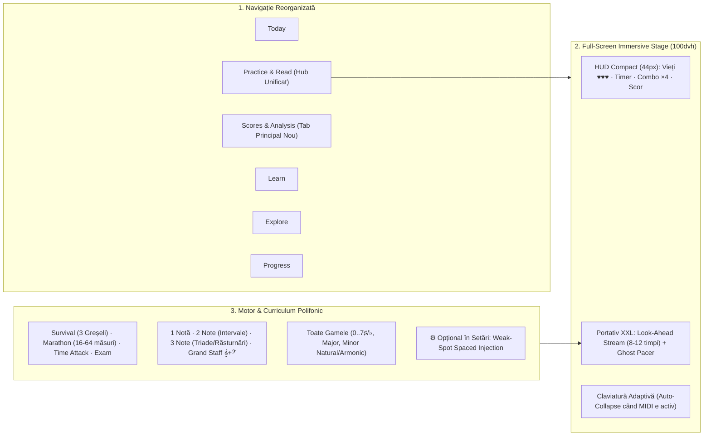

# Plan de Implementare: Redesign Practice & Sight-Reading (Stil *Complete Music Trainer*)

Acest plan detaliază transformarea secțiunii de antrenament din **Étude** într-o experiență imersivă, completă și progresivă, inspirată din *Complete Music Reading Trainer*, păstrând arhitectura strict tipată (Vite + TypeScript strict) și compatibilitatea cu toate testele existente.

---

## Faza 1: Reorganizarea Navigației & Separarea Tab-ului `Scores`

### Obiectiv
Scoaterea studioului de partituri (`Score & Analysis` + `Songs`) din sub-meniul `Practice` și promovarea lui ca pilon principal în bara de navigare de sus.

### Fișiere Modificate
- `src/domain/router.ts`:
  - Actualizarea `NAV_GROUPS` pentru a defini grupul principal `scores: ['analysis', 'songs']` și grupul `practice: ['read', 'practice', 'sing']`.
  - Păstrarea tuturor hash-urilor existente (`#analysis`, `#read`, `#practice`, `#songs`, `#sing`) pentru a nu rupe linkurile sau testele E2E.
- `etude.html`:
  - Adăugarea butonului principal `Scores` (`data-view="analysis"`, `data-i18n="nav_scores"`) în `<nav class="tabs" id="nav">`.
- `src/domain/views-runtime.ts`:
  - Sincronizarea barei secundare (`#modeBar`) și a meniului mobil (`#mobileMenu`) cu noua grupare.

---

## Faza 2: Modul Full-Screen „Immersive Stage” & Claviatură Adaptivă

### Obiectiv
Oferirea a **100% din ecran** portativului și claviaturii în timpul exercițiilor active, eliminând cei ~260px ocupați de antetele și descrierile statice.

### Fișiere Modificate
- `src/styles/etude.css`:
  - Reguli pentru `body[data-stage="immersive"]`: ascunde `<header>`, `#modeBar`, `.section-head`, `.lede`, `.rdx-tabs` și `footer`.
  - Transformă `#rdx-stage` și `#rdp-pieces` într-un container `height: 100dvh; display: flex; flex-direction: column; justify-content: space-between;`.
  - Scalare dinamică a portativului SVG (`.rdx-svg`, `#rd-staff`) pentru a ocupa tot spațiul vertical disponibil (`flex: 1`).
- `etude.html` & `src/domain/views-runtime.ts`:
  - **HUD Compact (44px):** Buton `← Ieșire (Esc)`, titlul nivelului/tonalității, indicatorul de vieți (`♥♥♥`), bara de timp de reacție, multiplicatorul de serie (`×1..×4`), scorul numeric și butonul de Fullscreen nativ (`document.documentElement.requestFullscreen()`).
  - **MIDI Auto-Collapse Dock:** Când un dispozitiv Web MIDI sau BLE MIDI este conectat, adaugă un comutator rapid pe dock pentru restrângerea claviaturii într-o bară subțire de status (28px), lăsând ~85% din ecran pentru portativ.

---

## Faza 3: Înlocuirea „1 Notă Statică” cu Fluxul Continuu (*Look-Ahead Stream*) & *Ghost Pacer*

### Obiectiv
Înlocuirea exercițiilor de tip „ghicește o singură notă pe un portativ gol” cu un șir continuu de note/intervale/acorduri pe portativ, astfel încât utilizatorul să antreneze citirea anticipativă (*look-ahead*) și intervallică încă de la Nivelul 1.

### Fișiere Modificate
- `src/domain/views-runtime.ts` (și un modul nou dedicat `src/sight-reading/stream.ts`):
  - **Buffer de 8–12 coloane pe portativ:** În loc ca `rdNext()` să randeze `cols: [[notaCurenta]]`, randează o fereastră glisantă de 8–12 timpi/măsuri.
  - La apăsarea notei/acordului corect, cursorul avansează instantaneu la coloana următoare, iar fereastra se completează lin în capătul drept.
  - **Ghost Pacer (Cursor Fantomă Opțional):** În modurile fără metronom obligatoriu (*Step-by-step*), un cursor secundar discret avansează la BPM-ul țintă pentru a-ți arăta vizual dacă ești înaintea sau în urma tempoului ideal.
  - *Notă:* Modul clasic de 1 singură notă rămâne disponibil doar ca opțiune secundară (*„Warm-up / Flashcard 1 notă”*) pentru începătorii absoluți.

---

## Faza 4: Modurile *Survival (3 Greșeli)*, *Marathon* și Motorul de Scor Arcade

### Obiectiv
Adăugarea modurilor de antrenament intens și a sistemului de punctaj din *Complete Music Trainer*.

### Fișiere Noi / Modificate
- Crearea `src/sight-reading/arcade.ts` (modul TypeScript strict, pur și testabil unitar):
  1. **Modul Survival (`♥♥♥` — Până greșești de 3 ori):**
     - Start cu `lives = 3`.
     - Fiecare coloană are o fereastră de timp de reacție (`targetMs`, ex. 3000 ms la început).
     - La fiecare 10 răspunsuri corecte consecutive, dificultatea crește (fereastra de reacție scade cu 6% până la un prag minim de 750 ms).
     - O notă greșită sau expirarea timpului pe nota curentă scade 1 viață (`♥`) și resetează multiplicatorul de combo. La `0` vieți, sesiunea se încheie cu ecranul de record (*High Score*, *Timp total supraviețuit*, *Note/Acorduri citite*, *Viteză medie în ms*).
  2. **Modul Marathon (16 / 32 / 64 măsuri):**
     - Generează o partitură extinsă (multi-sistem pe 2–3 rânduri vizibile simultan pe ecranul Full-Screen) și măsoară timpul total, acuratețea și **NPM (Notes Per Minute)**.
  3. **Modul Time Attack (90s):**
     - Contra-cronometru cu **+5 secunde bonus** la fiecare serie de 10 acorduri/note fără greșeală.
  4. **Motorul de Scor Arcade:**
     - $\text{Puncte} = (100 + \text{SpeedBonus}_{0..100}) \times \text{Multiplier}_{1\times..4\times}$
     - Praguri multiplicator: `1×` (0–4 serie), `2×` (5–14 serie), `3×` (15–29 serie), `4×` (30+ serie).

---

## Faza 5: Polifonie (2 și 3 Note Simultan), Grand Staff (`𝄞 + 𝄢`) și Toate Gamele

### Obiectiv
Extinderea generatorului și a curriculum-ului pentru a acoperi intervale armonice, acorduri de 3 note (inclusiv răsturnări) și citirea simultană pe ambele chei în orice gamă.

**Implementat:** curriculum-ul are patru niveluri avansate pentru bicorduri, triade cu răsturnări, grand staff și cromatism. Generatorul produce deterministic partituri cu 2–3 voci, în toate armurile de la 7♭ la 7♯, în Major, Minor natural, Minor armonic și Cromatic. Validatorul verifică vocile, armura și ortografia notelor; evaluatorul acceptă un acord numai dacă toate atacurile sale sunt în fereastra de 60 ms.

### Fișiere Modificate
- `src/sight-reading/model.ts` & `src/sight-reading/generator.ts`:
  - Extinderea modelului de evenimente pentru a suporta **polifonie pe fiecare mână** (`pitches: readonly number[]` / acorduri de 2–3 note simultan) și coordonare pe **Grand Staff (`𝄞 + 𝄢`)**:
    - **Polifonie 1 (Melodic):** 1 notă pe Cheia Sol, Cheia Fa sau alternativ pe Grand Staff.
    - **Polifonie 2 (Bicorduri / Intervale Armonice):**
      - *O singură mână:* Secunde, terțe, cvarte, cvinte, sexte, octave lovite simultan.
      - *Ambele mâini (`𝄞 + 𝄢`):* 1 notă în bas (`𝄢`) + 1 notă în sopran (`𝄞`) simultan.
    - **Polifonie 3 (Tricorduri / Triade & Răsturnări):**
      - *O singură mână:* Triade majore, minore, micșorate și mărite în stare directă (`5/3`), Sextacord (`6`) și Cvartsextacord (`6/4`).
      - *Ambele mâini (`𝄞 + 𝄢`):* 1 notă în bas (`𝄢`) + interval armonic de 2 note în dreapta (`𝄞`), sau bicord în stânga + melodie în dreapta.
  - **Suport complet de Tonalități și Game:**
    - Orice exercițiu poate rula în oricare dintre tonalitățile de pe Cercul Cvintelor (`0` până la `7♯ / 7♭`), în mod **Major**, **Minor Natural**, **Minor Armonic** (cu treapta a VII-a alterată ascendent) sau **Cromatic**.
  - **Shape Reading Hints (Opțional):**
    - Evidențierea vizuală a formei geometrice a acordului (stare directă vs răsturnarea I / II) și afișarea digitației standard (`1-3-5`, `1-2-5`, `1-3-5`).
- `src/sight-reading/evaluate.ts` & `src/domain/views-runtime.ts`:
  - Verificarea atacurilor simultane (fereastră de toleranță de `~60 ms` între degete pentru acordurile de 2 și 3 note, indiferent de ordinea milisecundelor în care atingi clapele).

---

## Faza 6: Injecție Inteligentă a Notelor Slabe (*Opțională din Setări*)

### Obiectiv
Utilizarea statisticilor de eroare și timp de reacție ale utilizatorului pentru a prioritiza notele/intervalele dificile, **controlată explicit printr-un comutator în Setări**.

### Fișiere Modificate
- `src/domain/storage.ts`:
  - Adăugarea proprietății `weakSpotInjection?: boolean` în interfața `AppSettings` (cu valoare implicită `false` sau `true`, păstrată la import/export și sincronizată între tab-uri).
- `etude.html`:
  - În panoul `#settings` → secțiunea **Learning** (`set_learning`), adăugarea comutatorului:
    - `<input type="checkbox" id="set-weak-inject">` — *„Smart weak-spot injection (focus more on notes and intervals where you hesitate)”* / *„Injecție inteligentă a punctelor slabe (insistă pe notele și intervalele unde eziți)”*.
  - Adăugarea unui indicator/toggle rapid și în bara de configurare din `Practice`.
- `src/domain/views-runtime.ts` & `src/sight-reading/generator.ts`:
  - **Când `settings.weakSpotInjection === true`:** Extrage din `rdData().nt` primele 25% cele mai lente/greșite poziții din gama curentă și le acordă o pondere de ~30% în generarea fluxului din *Practice / Survival / Marathon*.
  - **Când `settings.weakSpotInjection === false`:** Generatorul folosește exclusiv distribuția muzicală standard a nivelului, fără nicio influență din istoricul de greșeli.
  - *(Notă: Modul oficial `First-Sight Exam` rămâne întotdeauna 100% determinist pe bază de seed, ca să nu fie afectată corectitudinea examenului).*

---

## Faza 7: Localizare (7 Limbi) & Verificare Calitate

1. **Traduceri complete (`src/locales/index.js`):**
   - Toate etichetele noi (Survival, Marathon, Vieți, Combo, Polifonie, Tab-ul Scores, opțiunea din Setări pentru Injecția Notelor Slabe) traduse în toate cele **7 limbi** (`en`, `ro`, `de`, `es`, `fr`, `it`, `pt-BR`).
2. **Suite de Teste:**
   - **Unit Tests (`vitest`):** Teste pentru motorul `arcade.ts` (3 vieți, multiplicatori, scor), polifonia de 2–3 note în `generator.ts` pe toate armurile și comutatorul `weakSpotInjection` (ON vs OFF).
   - **E2E Tests (`playwright`):** Verificarea noului tab `Scores`, intrarea și ieșirea din modul Full-Screen Stage (`Esc`), rularea unui joc Survival până la 3 greșeli și verificarea setării de *Weak-Spot Injection*.
   - Toate porțile (`npm run typecheck`, `npm run lint`, `npm run test:unit`, `npx playwright test`, `npm run build`, `npm run build:standalone`) trebuie să treacă 100% pe verde.
