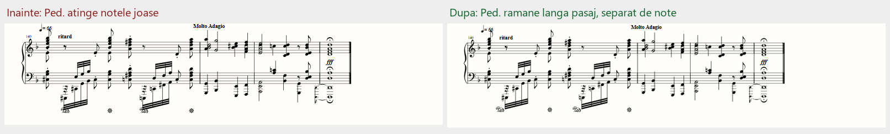

# Audit extins — importul celor cinci partituri

> Matricea a fost repetată după corecțiile găsite de review: identitatea fiecărui cap de notă și apartenența muzicală a fiecărui semn de pedală sunt acum verificate explicit, pe aceeași versiune HTML.

## Rezultat și acoperire

Au fost importate efectiv toate cele cinci fișiere MXL din cerere, nu doar fragmentele din teste. Controlul a acoperit **37 de pagini randate**, în **30 de combinații partitură/configurație**: pagină deschisă și închisă la culoare, lățime redusă, zoom 75%, zoom 125% și afișare continuă.

| Partitură | Măsuri | Note redabile | Pauze vizibile | Pagini sursă → rezultat | Sisteme sursă → rezultat |
|---|---:|---:|---:|---:|---:|
| Bach — Toccata and Fugue in D Minor | 143 | 4.120 | 218 | 8 → 10 | 52 → 52 |
| Dance of the Sugar Plum Fairy | 53 | 1.099 | 128 | 4 → 4 | 19 → 19 |
| Für Elise | 106 | 901 | 202 | 3 → 3 | 18 → 18 |
| Moonlight — mișcarea a III-a | 201 | 4.888 | 81 | 12 → 14 | 66 → 66 |
| You're a Mean One, Mr. Grinch | 51 | 1.582 | 107 | 4 → 6 | 16 → 16 |

**Conținut muzical verificat:** 12.590 note redabile și 736 de pauze vizibile. Notele legate sunt unificate pentru redare; ornamentele/grace notes și pauzele ascunse sunt păstrate în XML, dar nu sunt numărate ca note principale/pauze vizibile în tabel.

## Metodă

- Comparație independentă cu XML-ul original folosind un cititor Python cu durate raționale: înălțime MIDI, început, sfârșit, parte, portativ și voce. Evenimentele sunt comparate după ordonare pe timpul rotunjit, pentru a nu trata deriva de virgulă mobilă a trioletelor drept note diferite.
- Comparație structurală a **tuturor elementelor `<note>`** originale și importate: durate, pauze, legături, bare de grupare, articulații și alte notații din interiorul notelor. Rezultat: identice pentru toate cele cinci fișiere.
- Toate notele redabile au legături către simbolurile lor selectabile; fiecare cap de notă redat este verificat și după parte, portativ, voce, înălțime și acoperirea timpului său. Aceasta include continuări legate care coincid cu un nou unison în altă voce. Numărul pauzelor explicate corespunde pauzelor vizibile din fiecare sursă.
- Măsurare geometrică pe **fiecare pagină**, nu doar pe zona vizibilă: Ped./steluțe versus capete de note, tije, stegulețe, bare de grupare, modificatori, legături și text; Ped. versus alte semne de pedală; simboluri ieșite din pagină.
- Control suplimentar pentru liniile ajutătoare și grosimea liniilor, conturul local al legăturilor curbe, sistemul proprietar al pedalei, apropierea de măsura evenimentului și deplasarea limitată la patru spații de portativ pe fiecare axă față de poziția nativă. Literele unui marcaj pot traversa bara de măsură; nu se cere ca fiecare pixel al cuvântului să încapă între două bare.
- Capturi ale tuturor paginilor și revizuire vizuală a planșelor de ansamblu; verificări de detaliu pentru zona de pedală din finalul Bach și marginea de jos din Moonlight.
- Identitatea HTML-ului verificat este în `score-five-audit-results.json`. Fiecare rezultat a fost validat față de aceeași amprentă SHA-256.

## Defecte corectate și verificate

### 1. Ped. peste note joase — severitate medie, vizual

Baseline-ul salvat al auditului a înregistrat trei intersecții în Bach și nouă în Moonlight. Plasarea originală a motorului nu lua întotdeauna în calcul notația joasă și semnele de pedală apropiate. Prima soluție geometrică putea împinge un marcaj în sistemul următor; review-ul a respins această soluție. Corecția finală folosește proprietarul muzical al fiecărui grup SVG, caută și lateral față de note, rămâne în același sistem și în apropierea măsurii relevante și limitează deplasarea. Timpii evenimentelor de pedală nu se schimbă.

**Reproducere:** import Bach, finalul piesei, măsurile 140–141; respectiv import Moonlight și examinarea pasajelor cu marcaje de pedală pe ambele portative.

**După corecție:** zero intersecții măsurate cu notația sau între semnele de pedală în toate cele 30 de configurații. Marcajele rămân detectabile prin hover și focus. Reaplicarea corecției nu acumulează deplasări.

### 2. Steluță de pedală tăiată la marginea paginii — severitate medie, vizual

Auditul extins a găsit în Moonlight, pagina randată 7, o eliberare a pedalei care depășea marginea de jos. O căutare doar în jos sau lateral nu găsea întotdeauna un loc liber.

**Corecție:** căutarea include poziții libere apropiate deasupra marcajului, cu deplasare limitată și păstrarea distanței față de notație și de sistemul următor. Dacă nu există un loc sigur, randarea eșuează explicit cu mesajul localizat existent; nu declară reușită un simbol ascuns, suprapus sau ieșit din pagină. În cele cinci fișiere reale nu apare nicio astfel de eroare. Testele pentru margini, migrare și pagină complet ocupată au fost observate în starea eșuată și apoi au trecut.

**După corecție:** zero semne de pedală, capete de note, chei, armuri, măsuri sau etichete text tăiate în matricea verificată.

### 3. Legături și expresii — verificări suplimentare

Sunt acoperite prin regresii și verificarea fișierelor complete: unisonuri în voci diferite cu selecții distincte; continuarea legată a unei voci care nu trebuie asociată noului unison al altei voci; o notă ornamentală legată de nota principală fără reatac dublu; dinamici piano/forte scrise cu un font privat; distanțe variabile între sisteme, fără impunerea primei distanțe tuturor paginilor.

## Verificare tehnică

- **136/136 teste Playwright trec** pe această versiune.
- Toate cele cinci comparații independente ale notelor trec; toate cele cinci comparații structurale ale notației trec.
- În cele 30 de configurații: zero coliziuni în categoriile de mai sus, zero simboluri tăiate în categoriile controlate, zero note fără selecție sau cu identitatea altei voci, zero pauze vizibile fără explicație, zero marcaje de pedală migrate sau nerezolvate. Cele 380 de contururi de pedală din afișarea pe pagini sunt prezente; fișierul Sugar Plum nu conține marcaje de pedală și nu este tratat drept test de pedală trecut în mod vacuu.
- Zero excepții JavaScript și zero erori console în auditul complet.
- Review independent final al întregului diff: aprobat, fără defecte blocante de logică sau securitate; verificare statică separată de rulările efective de mai sus.
- Datele rezumate sunt salvate separat, fără a distribui integral aranjamentele muzicale atașate.

## Diferențe rămase și limite

**Nu este o copie pixel cu pixel a originalului.** Bach, Moonlight și Mr. Grinch au încă pagini suplimentare; ordinea și componența tuturor sistemelor se păstrează, dar sistemele care nu încap sunt continuate pe pagini suplimentare. Reducerea experimentală a spațiului minim dintre sisteme nu rezolvă uniform toate cele trei fișiere; nu a fost impusă o comprimare care ar putea recrea suprapuneri.

Indentările exacte, distanțele fine dintre note și formele glifelor rămân dependente de motorul de gravură. Auditul nu echivalează cu o comparație de tipar a fiecărui pixel și nu este o evaluare muzicală umană a interpretării audio. Fișierele originale nu au fost modificate.
